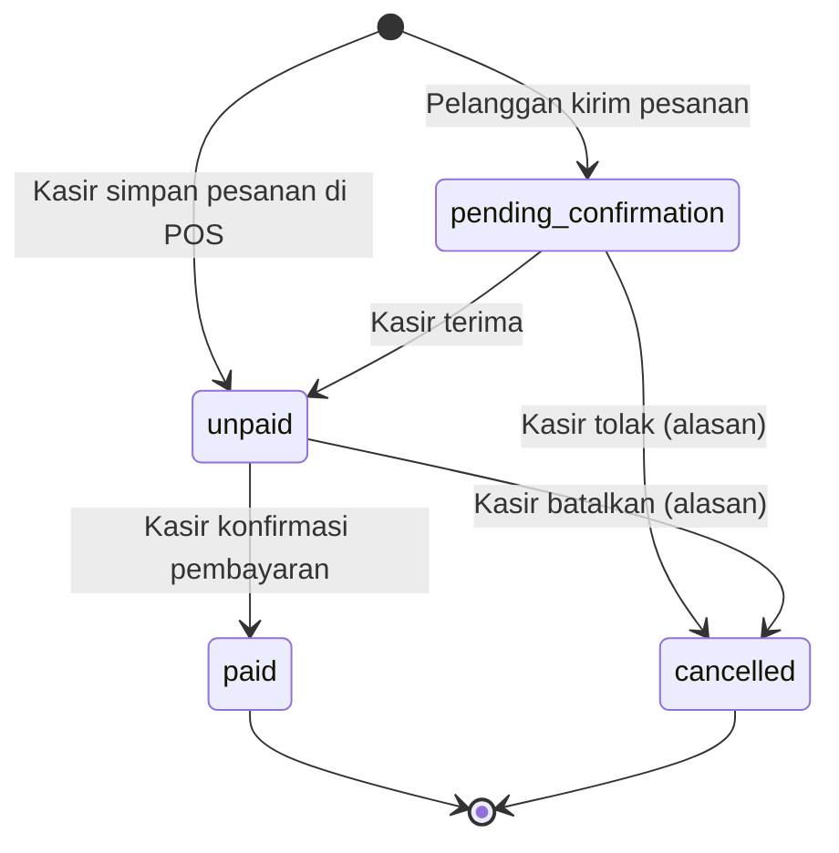
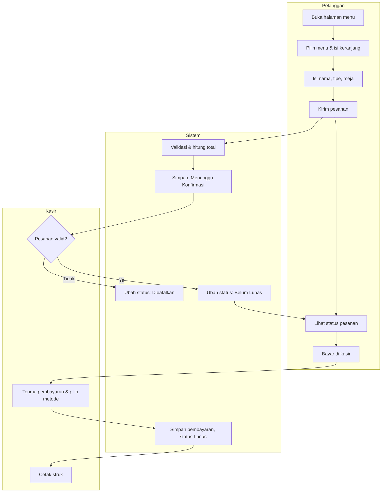

# 02 — Proses Bisnis KasirKita

Pemilik dokumen: `analis-bisnis`. Menjadi dasar activity diagram & BPMN di BAB III.

## 1. Proses berjalan (manual) vs proses usulan

| Aspek | Saat ini (manual) | Dengan KasirKita |
|---|---|---|
| Mencatat pesanan | Ditulis di nota kertas/buku | Diinput kasir di POS atau dikirim pelanggan dari HP |
| Menghitung total | Kalkulator / hitung kepala | Otomatis di server |
| Kembalian | Dihitung manual | Otomatis dari uang diterima |
| Status bayar | Nota dicoret / diingat | Status Belum Lunas → Lunas, tercatat siapa & kapan |
| Pembayaran non-tunai | Dicek di HP, tidak tercatat terpisah | Metode bayar tercatat + rekonsiliasi |
| Rekap harian | Menjumlah nota satu per satu | Rekap & laporan otomatis |
| Menu laris | Perkiraan | Laporan menu terjual |
| Data lama | Nota hilang/rusak | Tersimpan di database, bisa ditelusuri |

## 2. Status pesanan

| Kode (DB) | Label UI | Arti |
|---|---|---|
| `pending_confirmation` | Menunggu Konfirmasi | Dikirim pelanggan, belum dicek kasir |
| `unpaid` | Belum Lunas | Pesanan sah, menunggu pembayaran |
| `paid` | Lunas | Pembayaran dikonfirmasi kasir |
| `cancelled` | Dibatalkan | Ditolak kasir atau dibatalkan sebelum bayar |

Transisi lain **tidak diizinkan**. `paid` dan `cancelled` adalah status akhir.

## 3. Alur proses

### A. Pesanan langsung di kasir (walk-in)
1. Pelanggan menyebutkan pesanan di kasir.
2. Kasir membuka POS, memilih menu, mengatur jumlah, menambah catatan bila perlu.
3. Kasir memilih tipe: **Makan di tempat** (isi no. meja) atau **Bawa pulang**; isi nama pelanggan (opsional, default "Pelanggan").
4. Kasir menekan **Simpan** (status Belum Lunas) atau **Simpan & Bayar** (langsung ke langkah pembayaran).
5. Pembayaran → lihat alur C.

### B. Pesanan mandiri pelanggan
1. Pelanggan membuka halaman KasirKita (tautan atau scan QR di meja).
2. Jika usaha sedang **tutup** atau pesanan online dimatikan admin, tombol pesan nonaktif dengan pesan jelas.
3. Pelanggan memilih menu (menu Habis tidak bisa dipilih), mengatur jumlah & catatan.
4. Pelanggan mengisi nama, tipe pesanan, no. meja (jika makan di tempat), lalu **Kirim Pesanan**.
5. Sistem menyimpan pesanan **Menunggu Konfirmasi**, menampilkan kode pesanan dan tautan status.
6. Di panel kasir, badge **Pesanan Masuk** bertambah (cek otomatis tiap 15 detik).
7. Kasir mengecek (mis. pelanggan memang ada di meja tsb.) lalu **Terima** → Belum Lunas, atau **Tolak** + alasan → Dibatalkan.
8. Halaman status pelanggan ikut berubah (cek otomatis tiap 15 detik).
9. Pelanggan membayar di kasir → alur C.

### C. Konfirmasi pembayaran (manual)
1. Kasir membuka pesanan Belum Lunas → **Tandai Lunas**.
2. Kasir memilih metode:
   - **Tunai**: isi uang diterima (tombol cepat: Uang pas / 20rb / 50rb / 100rb). Sistem menampilkan kembalian. Uang kurang → tidak bisa disimpan.
   - **Transfer / QRIS**: kasir mengecek dana masuk di HP/m-banking, isi referensi (opsional), centang "Dana sudah diterima".
3. Kasir **Konfirmasi Lunas** → status Lunas, tercatat metode, nominal, kasir, waktu.
4. Kasir dapat **cetak struk** (P2).

### D. Pembatalan
1. Hanya untuk status Menunggu Konfirmasi atau Belum Lunas.
2. Wajib memilih/menulis alasan (pilihan cepat: "Pelanggan batal", "Menu habis", "Salah input", "Pesanan tidak valid", atau tulis sendiri).
3. Tercatat siapa membatalkan dan kapan. Data tidak dihapus.

### E. Rekap harian & rekonsiliasi
1. Akhir hari, kasir membuka **Rekap Hari Ini**: total transaksi, omzet per metode, **uang tunai yang seharusnya ada di laci**. Kasir mencocokkan dengan uang fisik (di luar sistem; tidak ada closing yang mengunci data).
2. Admin membuka **Laporan Metode Pembayaran**, membandingkan transaksi Transfer/QRIS dengan mutasi di m-banking, lalu mencentang **Sudah cocok** per transaksi (bisa sekaligus).
3. Transaksi non-tunai yang belum dicocokkan lebih dari 1 hari tampil sebagai peringatan di dashboard.

### F. Kelola menu
1. Admin menambah/mengubah menu (nama, kategori, harga, deskripsi, foto opsional).
2. Admin atau kasir menandai **Habis** / **Tersedia** (berlaku langsung di POS & halaman pelanggan).
3. Menu yang **belum pernah terjual** boleh dihapus permanen. Menu yang **sudah pernah terjual** hanya bisa **diarsipkan** (disembunyikan), supaya laporan lama tetap utuh.
4. Perubahan harga tidak mengubah transaksi lama (harga disimpan sebagai snapshot di item pesanan).

## 4. Aturan bisnis (Business Rules)

| ID | Aturan |
|---|---|
| BR-01 | Semua nilai uang dalam rupiah bulat (integer), tanpa desimal. |
| BR-02 | Harga & total selalu dihitung server dari data menu saat pesanan dibuat; nilai dari browser diabaikan. |
| BR-03 | Item pesanan menyimpan salinan nama menu & harga saat transaksi (snapshot). |
| BR-04 | Pesanan minimal 1 item; jumlah per item 1–99; maksimal 30 baris item per pesanan. |
| BR-05 | Menu berstatus Habis atau Arsip tidak bisa dipesan, baik dari POS maupun halaman pelanggan. |
| BR-06 | Pesanan tidak bisa diedit setelah disimpan (v1.0). Jika ada yang salah atau menu ternyata habis, kasir menolak/membatalkan dengan alasan, lalu membuat pesanan baru di POS. |
| BR-07 | Kode pesanan berformat `KK-YYMMDD-NNN`, berurutan per hari, unik. |
| BR-08 | Tautan status pelanggan memakai ID acak (ULID), bukan ID berurutan, agar tidak bisa ditebak. |
| BR-09 | Hanya status yang diizinkan diagram pada bagian 2 yang boleh terjadi. |
| BR-10 | Tunai: uang diterima ≥ total; kembalian = uang diterima − total. Uang diterima kosong = uang pas. |
| BR-11 | Transfer/QRIS: nominal dibayar = total (tidak ada kembalian); kasir wajib mencentang konfirmasi dana diterima. |
| BR-12 | Satu pesanan dibayar dengan satu metode (tidak ada bayar campuran). |
| BR-13 | Pesanan Lunas tidak bisa diubah, dibatalkan, atau dihapus. |
| BR-14 | Pembatalan/penolakan wajib alasan (min. 3 karakter). |
| BR-15 | Omzet dihitung hanya dari pesanan Lunas, berdasarkan **waktu bayar** (`paid_at`), zona waktu Asia/Jakarta. |
| BR-16 | Pesanan pelanggan hanya bisa dikirim saat pesanan online dibuka admin **dan** dalam jam buka. |
| BR-17 | Satu perangkat/IP maksimal 5 pengiriman pesanan per 10 menit (anti-spam). |
| BR-18 | Akun kasir yang dinonaktifkan tidak bisa login; transaksinya tetap tampil di laporan. |
| BR-19 | Kasir hanya bisa mengakses panel kasir; admin bisa mengakses panel kasir dan admin. |
| BR-20 | Menu yang sudah pernah terjual tidak bisa dihapus permanen, hanya diarsipkan. |

## 5. Activity diagram (acuan BAB III)

