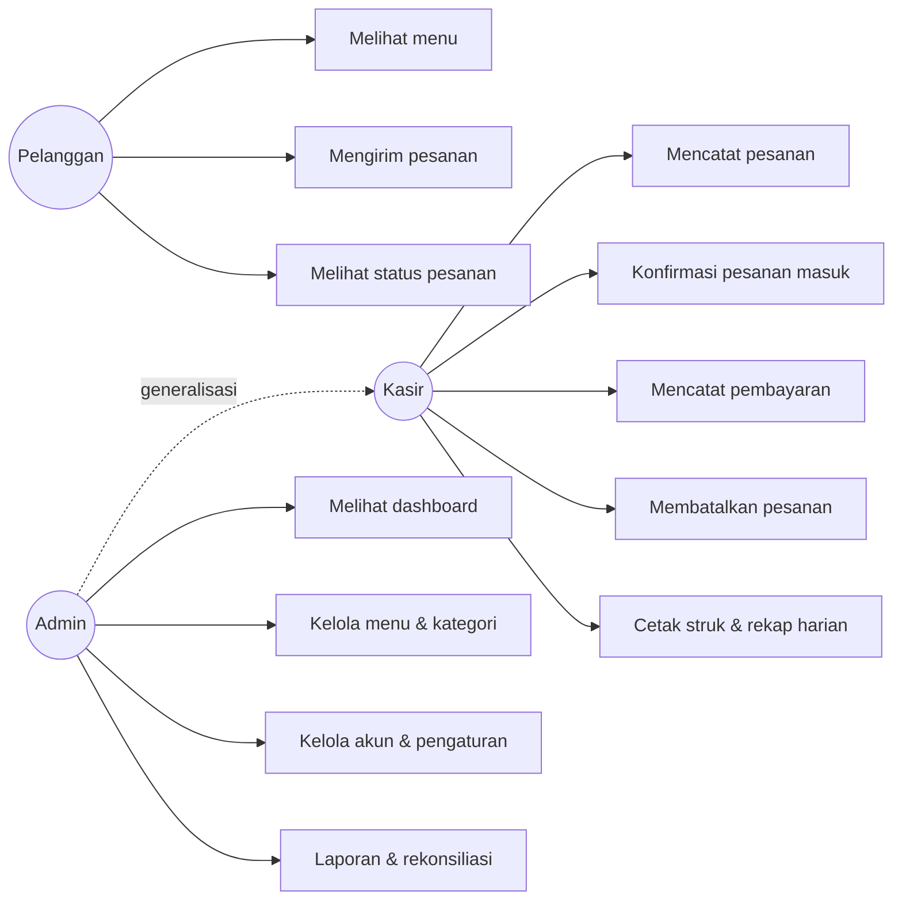

# 03 — Kebutuhan Sistem

Pemilik dokumen: `analis-bisnis`. ID fitur mengikuti `01-ruang-lingkup.md`. Setiap kebutuhan punya kriteria penerimaan (acceptance criteria, AC) yang dipakai `qa-engineer` untuk menguji.

## 1. Kebutuhan fungsional

### Pelanggan

**KF-01 Melihat menu & profil usaha (PL-01, PL-02) — P1**
- AC1: Halaman `/` menampilkan nama usaha, alamat, jam buka, dan label "Buka"/"Tutup" sesuai jam saat ini.
- AC2: Menu dikelompokkan per kategori sesuai urutan kategori; menu Arsip tidak tampil.
- AC3: Menu Habis tampil abu-abu dengan label "Habis" dan tidak bisa ditambahkan.
- AC4: Tampilan nyaman di layar 360px tanpa scroll horizontal.

**KF-02 Keranjang & kirim pesanan (PL-03, PL-04) — P1**
- AC1: Tambah/kurang jumlah, hapus item, catatan per item (maks. 100 karakter).
- AC2: Total di keranjang selalu sama dengan total yang disimpan server.
- AC3: Nama wajib (2–50 karakter); no. meja wajib jika "Makan di tempat".
- AC4: Saat toko tutup / pesanan online dimatikan, tombol kirim nonaktif dengan pesan alasan.
- AC5: Setelah kirim, pelanggan diarahkan ke halaman status yang menampilkan kode `KK-YYMMDD-NNN`.
- AC6: Pengiriman ke-6 dalam 10 menit dari perangkat yang sama ditolak dengan pesan ramah.

**KF-03 Status pesanan (PL-05, PL-06) — P1/P2**
- AC1: Halaman status menampilkan kode, waktu, rincian item, total, dan status terkini.
- AC2: Status diperbarui otomatis ≤ 15 detik setelah kasir mengubahnya, tanpa reload manual.
- AC3: Jika ditolak/dibatalkan, alasan ditampilkan.
- AC4 (P2): Menampilkan cara bayar: "Silakan bayar di kasir", info rekening, dan gambar QRIS statis jika diisi admin.
- AC5: Tautan status yang tidak ada → halaman 404 yang ramah.

### Kasir

**KF-04 Login & hak akses (KS-01) — P1**
- AC1: Login dengan username + password; salah → pesan "Username atau password salah" (tanpa menyebut mana yang salah).
- AC2: Setelah login: kasir → `/kasir`, admin → `/admin`.
- AC3: Kasir yang membuka URL `/admin/*` mendapat 403.
- AC4: Akun nonaktif tidak bisa login.
- AC5: Login dibatasi 5 percobaan gagal per menit.

**KF-05 POS (KS-02, KS-09) — P1/P2**
- AC1: Grid menu dengan tab kategori; menu Habis/Arsip tidak bisa dipilih.
- AC2: Keranjang: tambah/kurang/hapus, catatan per item, total berjalan.
- AC3: Tipe pesanan (Makan di tempat + no. meja / Bawa pulang) dan nama pelanggan opsional.
- AC4: "Simpan" → status Belum Lunas; "Simpan & Bayar" → langsung membuka form pembayaran.
- AC5: Keranjang kosong → tombol simpan nonaktif.
- AC6 (P2): Kasir bisa menandai menu Habis/Tersedia dari POS.

**KF-06 Pesanan masuk (KS-03) — P1**
- AC1: Daftar pesanan Menunggu Konfirmasi, terlama di atas, dengan rincian.
- AC2: Badge jumlah pesanan masuk di menu samping, diperbarui otomatis tiap 15 detik.
- AC3: "Terima" → Belum Lunas; "Tolak" → wajib alasan → Dibatalkan.

**KF-07 Pesanan aktif & pembatalan (KS-04) — P1**
- AC1: Daftar pesanan Belum Lunas dengan kode, waktu, pelanggan/meja, total, umur pesanan (mis. "12 menit lalu").
- AC2: "Batalkan" wajib alasan; hanya untuk status yang diizinkan (BR-09).

**KF-08 Pembayaran manual (KS-05) — P1**
- AC1: Pilih metode Tunai / Transfer / QRIS.
- AC2: Tunai: uang diterima opsional (kosong = uang pas), tombol cepat, kembalian tampil langsung; uang kurang → tombol konfirmasi nonaktif dan server menolak.
- AC3: Transfer/QRIS: wajib centang "Dana sudah diterima", referensi opsional (maks. 50 karakter).
- AC4: Setelah lunas: tercatat metode, nominal, kembalian, kasir, waktu; pesanan pindah ke riwayat.
- AC5: Dua kasir menekan "Konfirmasi Lunas" bersamaan pada pesanan yang sama → hanya satu yang berhasil.

**KF-09 Riwayat & detail (KS-06) — P1**
- AC1: Daftar transaksi hari ini (semua status), terbaru di atas, pagination 20.
- AC2: Detail transaksi menampilkan item, catatan, total, status, metode, kasir, waktu-waktu penting.

**KF-10 Struk (KS-07) — P2**
- AC1: Halaman cetak lebar 58mm/80mm (CSS print) berisi nama usaha, alamat, kode, tanggal-jam, kasir, item, total, metode, uang diterima, kembalian, catatan kaki.
- AC2: Tombol "Cetak" memanggil dialog cetak browser.

**KF-11 Rekap hari ini (KS-08) — P2**
- AC1: Menampilkan untuk kasir yang login (admin: semua kasir): jumlah transaksi lunas, omzet per metode, total, jumlah pembatalan, **uang tunai seharusnya** (jumlah tunai lunas hari ini).

### Admin

**KF-12 Dashboard (AD-01) — P1** → definisi metrik di `06-dashboard-dan-laporan.md`.
- AC1: Pilihan periode Hari ini / 7 hari / 30 hari / Bulan ini.
- AC2: Semua angka sama dengan hasil query manual pada data seeder (diuji `qa-engineer`).

**KF-13 Kelola kategori (AD-02) — P1**
- AC1: Tambah, ubah nama, atur urutan, hapus (hanya jika tidak ada menu di dalamnya).

**KF-14 Kelola menu (AD-03) — P1**
- AC1: Tambah/ubah: nama (wajib, unik per kategori), kategori, harga (1–10.000.000), deskripsi (opsional, 150 karakter), foto (P3, jpg/png/webp ≤ 1MB).
- AC2: Toggle Tersedia/Habis; Arsip/Pulihkan; Hapus hanya jika belum pernah terjual (BR-20).
- AC3: Daftar menu bisa dicari nama & difilter kategori.

**KF-15 Laporan (AD-04 s.d. AD-10)** → spesifikasi di `06-dashboard-dan-laporan.md`.
- AC umum: filter periode (preset + rentang tanggal kustom maks. 366 hari), angka konsisten dengan dashboard, halaman cetak rapi, export CSV (P2) dapat dibuka Excel dengan pemisah yang benar.

**KF-16 Kelola akun kasir (AD-11) — P2**
- AC1: Tambah kasir (nama, username unik, password min. 8 karakter), nonaktifkan/aktifkan, reset password.
- AC2: Admin tidak bisa menonaktifkan dirinya sendiri.

**KF-17 Pengaturan usaha (AD-12) — P2**
- AC1: Ubah nama usaha, alamat, telepon, jam buka & tutup, info rekening (teks), gambar QRIS statis (png/jpg ≤ 1MB), catatan kaki struk, saklar "Terima pesanan online".

**KF-18 QR meja (AD-13) — P3**
- AC1: Admin mengisi jumlah meja → halaman cetak berisi QR untuk `/?meja=N` (dibuat di browser dengan library JS lokal, tanpa layanan luar).

## 2. Kebutuhan nonfungsional

| ID | Kebutuhan |
|---|---|
| KNF-01 Kemudahan | Kasir baru bisa menyelesaikan satu transaksi tanpa pelatihan > 5 menit (diuji di UAT). |
| KNF-02 Responsif | Halaman pelanggan optimal di HP (≥ 360px); panel kasir optimal di tablet landscape & laptop; panel admin di laptop dan tetap bisa dipakai di HP. |
| KNF-03 Kinerja | Halaman utama tampil < 2 detik di jaringan lokal dengan data 10.000 transaksi (index database sesuai `04`). |
| KNF-04 Keamanan | Password di-hash (bawaan Laravel), CSRF aktif, validasi semua input, otorisasi per peran, rate limit login & pesanan, tautan status tidak bisa ditebak. |
| KNF-05 Integritas data | Pembuatan pesanan & pembayaran memakai transaksi database; tidak ada hard delete data transaksi. |
| KNF-06 Ketersediaan | Berjalan di komputer lokal UMKM (Laragon/XAMPP) maupun hosting PHP biasa; tanpa layanan eksternal wajib. |
| KNF-07 Aksesibilitas | Kontras teks cukup, label pada setiap input, target sentuh ≥ 44px, status tidak dibedakan warna saja. |
| KNF-08 Bahasa & format | Bahasa Indonesia; format Rp1.234.567; tanggal "16 Okt 2026 14:05" WIB. |

## 3. Use case (ringkas, untuk diagram BAB III)

| Aktor | Use case |
|---|---|
| Pelanggan | Melihat menu; Mengelola keranjang; Mengirim pesanan; Melihat status pesanan |
| Kasir | Login; Mencatat pesanan; Mengonfirmasi/menolak pesanan masuk; Mencatat pembayaran; Membatalkan pesanan; Mencetak struk; Melihat riwayat; Melihat rekap harian; Mengubah ketersediaan menu |
| Admin | (semua use case kasir) + Melihat dashboard; Mengelola kategori; Mengelola menu; Mengelola akun kasir; Mengatur profil usaha; Melihat & mengekspor laporan; Mencocokkan pembayaran non-tunai |

