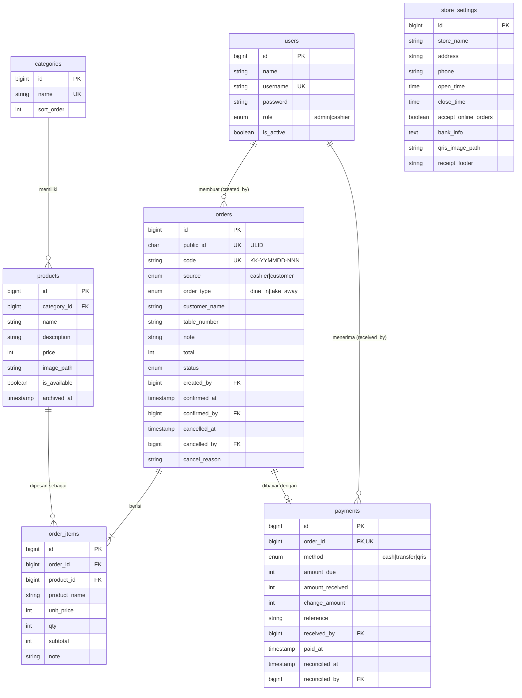

# 04 — Desain Data

Pemilik dokumen: `analis-bisnis` (desain) + `backend-dev` (implementasi migrasi). Perubahan skema setelah Fase 3 wajib memperbarui file ini dan kamus data.

## 1. ERD

## 2. Kamus data

### users
| Kolom | Tipe | Keterangan |
|---|---|---|
| id | bigint PK | |
| name | varchar(100) | Nama tampilan |
| username | varchar(30) unique | Untuk login, huruf kecil/angka/titik/garis bawah |
| password | varchar | Hash bawaan Laravel |
| role | enum('admin','cashier') | Peran |
| is_active | boolean default true | Nonaktif = tidak bisa login (BR-18) |
| remember_token, timestamps | | Bawaan |

### store_settings (selalu 1 baris)
| Kolom | Tipe | Keterangan |
|---|---|---|
| store_name | varchar(100) | Nama usaha (default "KasirKita Demo") |
| address | varchar(255) nullable | |
| phone | varchar(20) nullable | |
| open_time, close_time | time | Jam buka (BR-16). Jika close < open = buka melewati tengah malam |
| accept_online_orders | boolean default true | Saklar pesanan pelanggan |
| bank_info | text nullable | Teks bebas, mis. "BRI 1234-xxxx a.n. Warung Bu Sari" |
| qris_image_path | varchar nullable | Path gambar QRIS statis di storage public |
| receipt_footer | varchar(150) nullable | Catatan kaki struk |

Diakses lewat satu helper, mis. `StoreSetting::current()` (di-cache, cache dihapus saat disimpan).

### categories
| Kolom | Tipe | Keterangan |
|---|---|---|
| name | varchar(50) unique | Makanan, Minuman, Camilan, … |
| sort_order | smallint default 0 | Urutan tampil |

### products
| Kolom | Tipe | Keterangan |
|---|---|---|
| category_id | FK categories, restrictOnDelete | |
| name | varchar(100) | Unik per kategori |
| description | varchar(150) nullable | |
| price | unsigned int | Rupiah (BR-01) |
| image_path | varchar nullable | P3 |
| is_available | boolean default true | Tersedia / Habis |
| archived_at | timestamp nullable | Terisi = diarsipkan (tidak tampil) |

Index: `(category_id, archived_at)`.

### orders
| Kolom | Tipe | Keterangan |
|---|---|---|
| public_id | char(26) unique | ULID untuk tautan status pelanggan (BR-08) |
| code | varchar(20) unique | `KK-YYMMDD-NNN` (BR-07) |
| source | enum('cashier','customer') | Asal pesanan |
| order_type | enum('dine_in','take_away') | |
| customer_name | varchar(50) | Default "Pelanggan" |
| table_number | varchar(10) nullable | Wajib jika dine_in |
| note | varchar(150) nullable | Catatan pesanan |
| total | unsigned int | Dihitung server (BR-02) |
| status | enum('pending_confirmation','unpaid','paid','cancelled') | Lihat `02` |
| created_by | FK users nullable | Null jika dari pelanggan |
| confirmed_at, confirmed_by | nullable | Untuk pesanan pelanggan yang diterima |
| cancelled_at, cancelled_by, cancel_reason | nullable | BR-14 |
| timestamps | | `created_at` = waktu pesan |

Index: `status`, `created_at`, `(status, created_at)`.

### order_items
| Kolom | Tipe | Keterangan |
|---|---|---|
| order_id | FK orders cascadeOnDelete | (orders tidak pernah dihapus, cascade hanya pengaman) |
| product_id | FK products nullable nullOnDelete | Referensi menu |
| product_name | varchar(100) | Snapshot (BR-03) |
| unit_price | unsigned int | Snapshot |
| qty | unsigned tinyint | 1–99 |
| subtotal | unsigned int | unit_price × qty |
| note | varchar(100) nullable | Catatan item ("pedas") |

Index: `product_id`.

### payments
| Kolom | Tipe | Keterangan |
|---|---|---|
| order_id | FK orders unique | 1 pesanan = 1 pembayaran (BR-12) |
| method | enum('cash','transfer','qris') | |
| amount_due | unsigned int | = orders.total |
| amount_received | unsigned int | Tunai: uang diterima; non-tunai: = amount_due |
| change_amount | unsigned int | Tunai saja |
| reference | varchar(50) nullable | Non-tunai |
| received_by | FK users | Kasir yang mengonfirmasi |
| paid_at | timestamp | Dasar semua perhitungan omzet (BR-15) |
| reconciled_at, reconciled_by | nullable | Rekonsiliasi non-tunai |

Index: `paid_at`, `(method, paid_at)`, `(received_by, paid_at)`.

## 3. Catatan implementasi

- Gunakan **Enum PHP** (`App\Enums\OrderStatus`, `PaymentMethod`, `OrderType`, `OrderSource`, `UserRole`) dengan method `label()` & `color()` untuk UI. Cast di model.
- Kode pesanan dibuat di dalam transaksi DB: kunci baris pesanan hari itu (`lockForUpdate`) lalu ambil nomor berikutnya; unique index sebagai pengaman terakhir.
- Pembayaran: di dalam transaksi, `lockForUpdate` pesanan, cek status masih `unpaid` (KF-08 AC5).
- Seeder demo (`DemoSeeder`): 1 admin (`pemilik`), 2 kasir (`kasir1`, `kasir2`), 4 kategori, ±20 menu, **pesanan 30 hari terakhir** dengan pola realistis (ramai jam 11–13 & 18–20, akhir pekan lebih ramai, ±5% batal, campuran metode bayar ±60% tunai / 25% QRIS / 15% transfer, sebagian non-tunai belum direkonsiliasi). Password demo ditulis di README, bukan di kode produksi.
